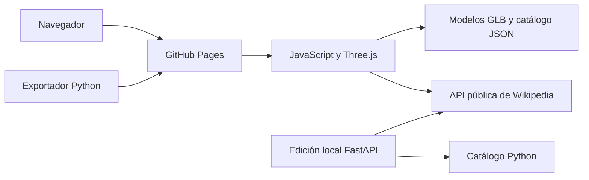

# Atlas de anatomía 3D

Visor educativo para explorar estructuras anatómicas, buscar piezas, aislar músculos y consultar fichas. La edición pública funciona en GitHub Pages; la edición local utiliza Python y FastAPI.

[Abrir demostración](https://bastiiiuuu.github.io/anatomia-mvp/) · [Guía técnica y de pruebas](docs/guia-tecnica.md)

## Contexto y participación

Proyecto desarrollado con apoyo de IA. Forma parte de un portafolio de formación y no acredita experiencia laboral ni dominio individual de cada técnica presente en el código. Los modelos anatómicos proceden de terceros y conservan sus licencias y atribuciones. El código y las decisiones deben poder explicarse y verificarse durante una demostración.

## Tecnologías presentes

JavaScript, Three.js, Web Workers, Python, FastAPI, HTTPX, unittest y GitHub Actions. La visualización pública carga modelos GLB y datos estáticos; FastAPI no se ejecuta en GitHub Pages.



## Ejecución local

Requiere Python 3.13. No requiere Blender para explorar los modelos existentes.

```powershell
git clone https://github.com/bastiiiuuu/anatomia-mvp.git
cd anatomia-mvp
python -m venv .venv
.\.venv\Scripts\python.exe -m pip install -r requirements-lock.txt
.\.venv\Scripts\python.exe -m uvicorn backend.main:app --host 127.0.0.1 --port 8000
```

Abre `http://127.0.0.1:8000/`. Three.js se carga desde CDN y las consultas de Wikipedia requieren red. Una falla de Wikipedia conserva la ficha local. Para probar en una tablet de la misma red, consulta las opciones de start.ps1 en la guía técnica.

## Demostración sugerida

Buscar una estructura, seleccionarla, aislarla y restaurar el contexto. Comparar regiones y observar la carga diferida de capas. Abrir una ficha de Wikipedia y comprobar el estado sin red. Las fichas son material educativo y no sustituyen una revisión docente o una fuente clínica.

## Verificación

```powershell
.\.venv\Scripts\python.exe -m unittest discover -s tests -v
.\.venv\Scripts\python.exe tools/export_pages.py
```

Las 27 pruebas Python cubren contratos de API, correspondencia entre modelos y fichas, búsquedas, exportación estática y controles del colector de estadísticas. Los scripts de navegador y sus requisitos están en la guía técnica. No se publican promesas de FPS universales ni mejoras de rendimiento sin su contexto de medición.

## Licencias y privacidad

Conservar `static/models/SOURCES.md`, los avisos de Z-Anatomy/BodyParts3D/DBCLS y las licencias de los assets y Draco. Los recursos ajenos no se presentan como modelos creados por el autor.

El colector opcional de estadísticas es un servicio separado y tiene datos privados fuera del artefacto público. Consulta su funcionamiento y la opción de exclusión en la guía y en el visor. El nuevo portafolio no necesita ni incorpora ese colector.


